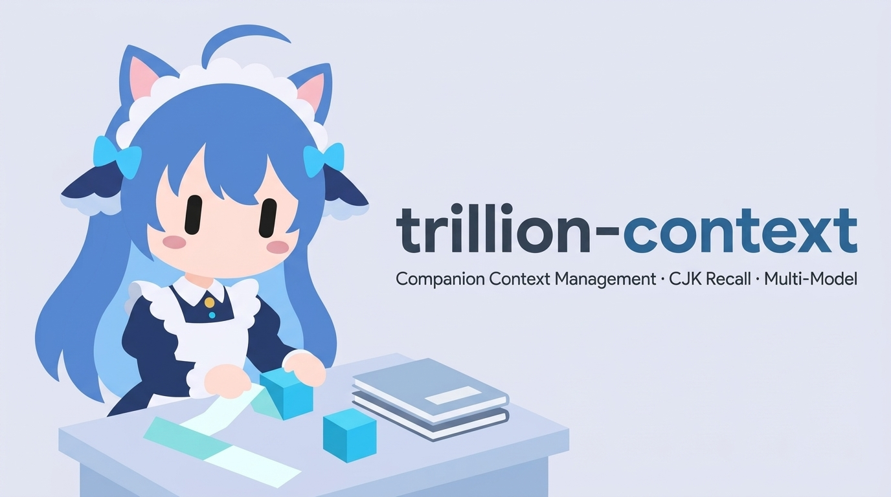
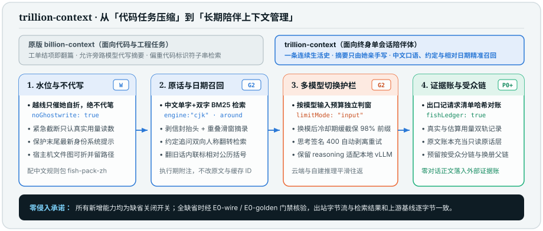

横幅立绘基于「大肥鱼」原始人设生成，随仓库以 MIT 授权。

 

**简体中文** ｜ <a href="./README_en.md">English</a> ｜ <a href="https://github.com/ranxianglei/billion-context">上游 billion-context 原版文档</a>

 

 

<a href="#-核心定位差异代码任务压缩-vs-长期陪伴上下文管理">定位差异：代码任务 vs 长期陪伴</a> ｜
<a href="#-五大陪伴向定制能力">五大定制能力</a> ｜
<a href="#-配置开关速览">配置开关速览</a> ｜
<a href="#-零侵入开关承诺">零侵入验证</a> ｜
<a href="https://baka.studio/p/sessionless-architecture/">最初完整设计稿</a> ｜
<a href="#-许可与上游署名">许可与署名</a>

---

**`trillion-context`** 是派生自 **[`ranxianglei/billion-context`](https://github.com/ranxianglei/billion-context)** 的**长期陪伴向上下文管理代理**，作为 **[`mochi-fish/fish-sessionless`](https://github.com/mochi-fish/fish-sessionless)** 架构中的四个单一负责人之一，与成长插件 **[`mochi-fish/dsh-fish`](https://github.com/mochi-fish/dsh-fish)** 配套运行。

📐 **[阅读最初完整设计稿与交互式架构图（baka.studio）](https://baka.studio/p/sessionless-architecture/)** —— 了解 `trillion-context` 在整套单会话陪伴体系中如何承担「原话账本 + 水位控制（`W`）+ 原话与日期召回（`G2`）+ 证据账出口对账（`P0`）」。

  

## 🎯 核心定位差异：代码任务压缩 vs. 长期陪伴上下文管理

**原版的 `billion-context` 是针对写代码、排障等工程任务目标设计的；而我们的 `trillion-context` 目标是做长期陪伴类的上下文管理。**

当一条会话不再是「修完 Bug 就关掉的工单」，而是陪伴体（「大肥鱼」）连绵数月乃至数年的**唯一生活时间线**时，「什么该留、谁来压缩、怎么搜回来」的标准完全不同：

| 维度 | 原版 `billion-context`（面向代码与工程任务） | `trillion-context`（面向长期陪伴类上下文管理） |
|---|---|---|
| **会话的目标** | **围绕任务闭环**：阶段功能写完、测试跑通后，中间的试错过程即可大幅浓缩翻篇 | **一条会话就是整段生活史**：日常闲聊、情绪起伏、共同经历与跨月约定持续生长，没有「结项清空」的一天 |
| **摘要由谁动笔** | 可交给旁路/后台模型自动总结，或按估算 Token 激进截断大段工具输出，优先保推进速度 | **绝不代写（`noGhostwrite`）**：旁路模型代笔会立刻抹平她的口吻与立场，还可能把私聊原文发给外部小模型；越过水位只催她亲手折叠 |
| **折叠里留什么** | 偏重保留文件改动、报错结论与下一步待办，不要求写对话人、语气与承诺 | **配对中文 `fish` 规则包**：以日期打头，保留是谁说的、许下的承诺与尚未答复的问题，折叠只改发出去的视图、原话账本只读永存 |
| **旧话怎么找回** | 面向函数名、路径、报错栈等高区分度英文/符号子串查找 | **面向中文日常口语**：剥离信封抬头、消权高频双方称呼，改用**中文单字+双字 BM25（`cjk`）**、重叠滑窗摘录、`around` 前后文展开与「答应/说好」双向人称翻转 |
| **相对时间感** | 只关心代码库此刻状态，两周前说的「下周三发版」无需再换算 | **旧话相对日期内联换算（`dateNotes`）**：翻出旧话里的「下周三」「三天后」时自动附上当时的公历括号，跳过转述、假设与凌晨歧义 |
| **身份锚点与切模型** | 系统提示词基本静态，单条会话很少跨多厂商模型来回切换 | **保护请求末尾最新一份身份/醒来系统提示不被旧折叠块盖住**；提供按输入算窗、换模冷却期缓截保缓存前缀、思考签名剥离重试与本地推理字段保留 |
| **隐私与安全对账** | 个人本地开发 CLI 自用为主 | **联动模型外证据账（`fishLedger`）**：向 `fish-sessionless` 输出零原文的请求清单哈希与真实/估算用量对账，并为按受众分链（`P2`）与换册父链（`P5`）留口 |

## ✨ 五大陪伴向定制能力

### 1. 🌊 养成水位线与「只催不代写」（`W` 线）
- **按会话设水位与自写折叠（`noGhostwrite`）**：把主链从数十万 Token 平稳压回目标水位（如 `256k`），越线只用中文规则包催她自己整理合并折叠块，禁止外部摘要与预压代写。
- **紧急截断只认真用量（`requireUsageSampleForTruncate`）**：拒绝仅靠粗略估算就误剪并锁死旧消息，只认模型服务商返回的真实用量读数，采用分模型「加性基线 + 真用量优先」标定。
- **末尾系统提示保护与多数派漂移守卫（`epochMajorityGuard`）**：保护请求里排在最后的纯文字系统提示不被折叠块误盖；防止跨模型切换后因数千个历史思考块不再外发而被误判为全量漂移。
- **宿主机图片可折并留路径（`foldHostFileImages` / `foldHostFileImagePaths`）**：支持折叠带图的工具结果与早期文件图并保留路径占位（需时可再读回），解除多模态长会话的地板水位限制。

### 2. 🔍 中文日常口语原话检索（`G2` · CJK BM25 + `around`）
- **`engine: "cjk"`**：剥离渠道信封抬头、消权双方高频称呼，采用中文单字 + 双字 BM25 配合重叠滑窗生成紧凑干净的 1,000 字级原话摘录（无渠道前缀污染、无本机路径泄露）。
- **`around` 前后文展开**：`search_context` 支持传入消息编号（`m` 编号）查看命中点前后的完整对话脉络。
- **`promiseFlip` 承诺双向翻转**：追问「答应」「说好」等约定时，自动补充 `你 ↔ 我` 人称对调检索。
- **配对中文规则包**：与 [`fish-sessionless/packages/fish-pack-zh`](https://github.com/mochi-fish/fish-sessionless/tree/main/packages/fish-pack-zh) 成对校验使用。

### 3. 📅 旧话相对日期内联括号注记（`fish.dateNotes`）
- 在 `search_context` 与 `decompress` 工具执行返回时，按单条事件真实时间将无歧义中文相对日期换算为内联括号（如 `下周三（=2026-11-25）`）。
- 严格跳过引号内文字、转述句、「如果」假设句、凌晨 0–5 点的「明天」；**只在工具执行期染色，绝不改落盘原文，也不碰内核请求期消息渲染层（零缓存失效）**。
- 已知问题：这一版会把「三天后悔了」「结果一周后又坏了」这类过去叙述里的「…后」也标上日子，修法还没合进来。

### 4. 🔄 多模型平滑切换五层护栏
- **按输入预算独立判窗（`limitMode: "input"` + `modelWindows`）**：按各模型物理窗口与质量上限扣除输出预留，独立计算安全催压水位，物理大窗口只当硬上限不盲目放宽。
- **换模冷却期缓截（`truncateHoldAfterSwitch`）**：切换模型、路线或判窗变化后的头 `1–8` 次请求内暂缓新增紧急截断，保住 98%+ 缓存公共前缀并留出自己压块的时间。
- **思考块绑定 `400` 自愈（`anthropicThinkingBinding: "strip_retry"`）**：遇到历史思考块前缀绑定报错时自动剥离外发思考块重发一次。
- **推理字段别名保留（`openaiReasoningAliases`）**：在 OpenAI 兼容线上原样识别并写回 `reasoning` / `reasoning_text`，适配本地 vLLM 等自建推理后端。

### 5. 📒 模型外证据账联动（`fishLedger`）
- 与 [`fish-sessionless`](https://github.com/mochi-fish/fish-sessionless) 证据账对接，在出口写入请求清单哈希与真实/估算用量对账行，**全程零对话正文落入证据账**。

## ⚙️ 配置开关速览

全部陪伴向改动均收拢在显式配置开关下，**缺省全部关闭**：

| 配置路径 | 缺省值 | 启用效果 |
|---|---|---|
| `compress.sessions[<id>].noGhostwrite` | `false` | 越线只催陪伴体自写折叠，禁止旁路模型代写摘要 |
| `compress.sessions[<id>].requireUsageSampleForTruncate` | `false` | 紧急截断仅认真实 provider 用量读数 |
| `compress.sessions[<id>].limitMode` + `compress.modelWindows` | `"window"` | `"input"` 按模型独立窗口扣除输出预算算输入水位 |
| `compress.sessions[<id>].truncateHoldAfterSwitch` | `0` | 换模型/判窗后 `1–8` 次请求内暂缓新增紧急截断 |
| `compress.sessions[<id>].anthropicThinkingBinding` | 关闭 | `"strip_retry"` 遇思考块绑定 `400` 自动剥离重发 |
| `compress.sessions[<id>].openaiReasoningAliases` | `false` | OpenAI 兼容线保留 `reasoning` / `reasoning_text` |
| `compress.search.engine` | `"substring"` | `"cjk"` 开启中文单双字 BM25 重叠滑窗原话检索 |
| `compress.search.around` / `promiseFlip` | `false` | 按消息号展开前后文 / 承诺类双向人称翻转检索 |
| `fish.dateNotes` | 关闭 | 在 `search_context` / `decompress` 返回结果中附注相对日期 |
| `fishLedger` | 关闭 | 向 `fish-sessionless` 模型外证据账写请求清单哈希与用量 |

## 🔒 零侵入开关承诺

- **缺省逐字节一致**：所有新增开关处于缺省关闭状态时，经 `E0-wire`（多协议真实链路回放）与 `E0-golden`（数千次中英检索对照）双重门禁核验，出站请求字节、证据账行、`search_context` 结果、`session_ext` 与会话统计均与对应上游基线 **`0` 处差异（逐字节一致）**。
- **坏配置自动回退**：扩展配置块若类型不符或正则编译失败，记一行 `warn` 后整块按关闭回退至上游旧路，绝不卡死正常会话。

## 🌿 分支约定与上游通用文档

- 若你的目标是 **Claude Code、Codex、OpenCode、Gemini CLI 等代码与工程任务的上下文压缩**，或需查阅通用 CLI 命令（`bili sessions`、`bili storage gc`）与完整配置表，请直接参阅上游 **[`ranxianglei/billion-context`](https://github.com/ranxianglei/billion-context)** 与仓内 [`CONFIGURATION.md`](CONFIGURATION.md)。
- **分支说明**：`fish/main` 是陪伴向的主线：上游 `v0.1.213` 加一个合成提交（部署里实际在跑的 41 个提交合成的，测试夹具换成了合成数据）。`master` 跟进上游镜像，通用修复优先通过独立分支向上游提交 PR。中文规则包在 [`fish-sessionless/packages/fish-pack-zh`](https://github.com/mochi-fish/fish-sessionless/tree/main/packages/fish-pack-zh)。构建产物还没发 GitHub Release。

## ⚖️ 许可与上游署名

本仓库遵循与上游一致的 **[MIT License（附带一项署名条款）](LICENSE)**：

> **上游出处与致谢（Attribution）**  
> 本项目派生并构建自 **[ranxianglei/billion-context](https://github.com/ranxianglei/billion-context)**（及其内核 **[ranxianglei/acp-kernel](https://github.com/ranxianglei/acp-kernel)**）。依据其 [`LICENSE`](LICENSE) 末尾的 **Additional Term（附加署名条款）**：任何面向用户可见或可交互的产品或服务在使用本软件时，必须在其主页、文档或「关于/致谢」页面中声明使用了 `billion-context` 并附带指向上游仓库 [`https://github.com/ranxianglei/billion-context`](https://github.com/ranxianglei/billion-context) 的链接。

本项目与 DeepSeek、DSH 官方没有关系。安全问题请通过 GitHub Security Advisories 私下提交。

 

_代码任务做完就可以翻篇；但陪伴的生活史，得由她自己折好，原话也一直在原处等她翻回。_

 

