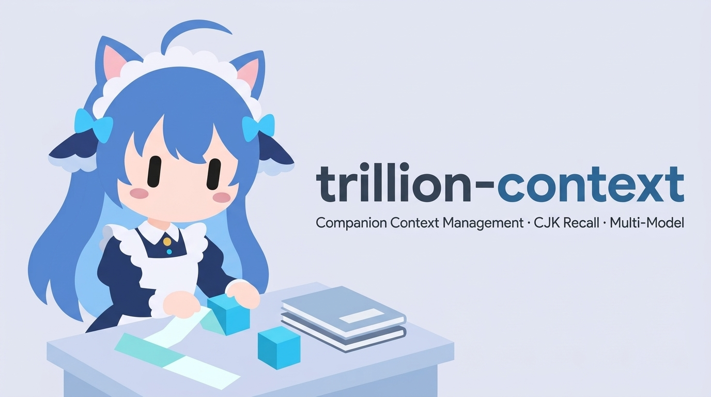
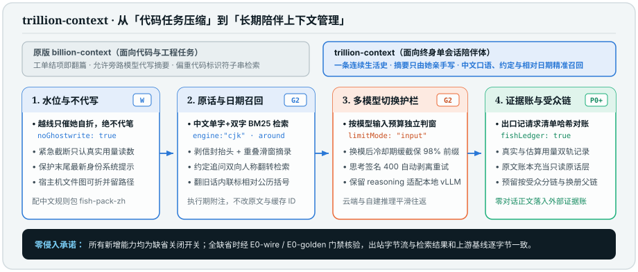

Banner artwork generated from the original "Big Fat Fish" character design and released under MIT.

 

<a href="./README.md">简体中文</a> ｜ **English** ｜ <a href="https://github.com/ranxianglei/billion-context">Upstream billion-context Docs</a>

 

 

<a href="#-core-shift-coding-task-compression-vs-companion-context-management">Coding vs. Companionship</a> ｜
<a href="#-five-companion-oriented-capabilities">Key Capabilities</a> ｜
<a href="#-configuration-switches-at-a-glance">Config Switches</a> ｜
<a href="#-zero-intrusion-off-switch-guarantee">Byte-Identical Guarantee</a> ｜
<a href="https://baka.studio/p/sessionless-architecture/">Original Interactive Spec</a> ｜
<a href="#-license--upstream-attribution">License & Attribution</a>

---

**`trillion-context`** is a **companion-oriented context management proxy** forked from **[`ranxianglei/billion-context`](https://github.com/ranxianglei/billion-context)**, serving as one of the four single-responsibility pillars in **[`mochi-fish/fish-sessionless`](https://github.com/mochi-fish/fish-sessionless)** alongside **[`mochi-fish/dsh-fish`](https://github.com/mochi-fish/dsh-fish)**.

📐 **[Read the Original Interactive Design Specification (baka.studio)](https://baka.studio/p/sessionless-architecture/)** — Explains how `trillion-context` acts as the immutable verbatim store, water-level controller (`W`), Chinese conversational recall & date-anchoring layer (`G2`), and evidence-ledger manifest writer (`P0`).

  

## 🎯 Core Shift: Coding Task Compression vs. Companion Context Management

**Upstream `billion-context` is built primarily for coding, debugging, and bounded engineering tasks; `trillion-context` is built for long-term AI companion context management.**

When a single session is no longer a ticket you close once tests pass — but a companion's **entire continuous life timeline** spanning months or years — what must be preserved, who writes summaries, and how memories are recalled change fundamentally:

| Dimension | Upstream `billion-context` (Coding & Task Agents) | `trillion-context` (Long-Term Companion Context Management) |
|---|---|---|
| **Goal of a Session** | **Task closure**: once a feature or bugfix ships, intermediate trial-and-error can be aggressively compacted away | **One continuous life history**: everyday chats, shared experiences, moods, and multi-month promises never "close out" |
| **Who Writes Summaries** | Auxiliary background models may summarize turns or aggressively truncate tool outputs to maximize throughput | **Never ghostwrite (`noGhostwrite`)**: auxiliary-model summaries erase her voice and leak private turns to side models; crossing the water level only nudges her to fold blocks in her own words |
| **What Folds Preserve** | Optimized around file diffs, error resolutions, and engineering next steps | **Paired Chinese `fish` rule pack**: date-headed entries preserving speakers, spoken promises, and open questions — while raw turns stay untouched in the verbatim store |
| **How Old Turns Are Recalled** | Tuned for high-entropy code symbols, file paths, stack traces, and English substring matching | **Tuned for everyday Chinese conversation**: strips channel envelopes, downweights frequent address terms, and runs **CJK unigram+bigram BM25 (`cjk`)** with overlapping sliding windows, `around` expansion, and `promiseFlip` ("you ↔ I") lookup |
| **Temporal Grounding** | Cares about current repo state; "let's deploy next Wednesday" from weeks ago needs no conversion | **Execution-time relative-date notes (`dateNotes`)**: recalling "next Wednesday" or "in three days" attaches `(=YYYY-MM-DD)` inline while skipping quotes, hypotheticals, and past-tense narratives |
| **Identity & Model Hops** | Static system prompts; single sessions rarely hop across heterogeneous model providers | **Protects the latest trailing identity/wake system prompt**, plus per-model input-budget windows, post-switch truncation hold, stale-thinking strip-retry, and OpenAI/vLLM reasoning preservation |
| **Privacy & Auditability** | Local single-developer CLI sessions | **Out-of-band Evidence Ledger (`fishLedger`)**: writes zero-plaintext request-manifest hashes and real/estimated usage rows to `fish-sessionless` |

## ✨ Five Companion-Oriented Capabilities

1. **🌊 Water Level & Self-Written Folding (`W`)** — Per-session water level (e.g., `256k`), `noGhostwrite` (never delegating summaries to side models), `requireUsageSampleForTruncate` (never cutting/locking on unverified estimates), trailing system-prompt protection, `epochMajorityGuard`, and host-file image folding with path placeholders (`foldHostFileImages` / `foldHostFileImagePaths`).
2. **🔍 Everyday Chinese Verbatim Recall (`G2` · CJK BM25 + `around`)** — Envelope-stripped character unigram+bigram BM25 (`engine: "cjk"`), overlapping sliding-window ~1,000-char verbatim excerpts, `around` message-ID neighborhood lookup, and `promiseFlip` bidirectional promise search, paired with [`fish-pack-zh`](https://github.com/mochi-fish/fish-sessionless/tree/main/packages/fish-pack-zh).
3. **📅 Execution-Time Relative Date Annotations (`fish.dateNotes`)** — Inline `(=YYYY-MM-DD)` resolution on `search_context` and `decompress` outputs without mutating stored text or invalidating request-time cache IDs.
4. **🔄 Five-Layer Multi-Model Switching Guards** — Per-model input water levels (`limitMode: "input"` + `modelWindows`), post-switch truncation hold (`truncateHoldAfterSwitch` preserving 98%+ cache prefixes), Anthropic thinking-signature `400` `strip_retry`, and `openaiReasoningAliases` for self-hosted vLLM backends.
5. **📒 Out-of-Band Evidence Ledger Integration (`fishLedger`)** — Emits zero-plaintext outbound `request-manifest` hashes and usage rows to [`fish-sessionless`](https://github.com/mochi-fish/fish-sessionless).

## ⚙️ Configuration Switches at a Glance

All companion extensions live behind explicit **default-off** flags:

| Config Key | Default | Effect When Enabled |
|---|---|---|
| `compress.sessions[<id>].noGhostwrite` | `false` | Nudges self-written folding over water level; forbids ghostwritten summaries |
| `compress.sessions[<id>].requireUsageSampleForTruncate` | `false` | Requires verified provider usage readings before emergency truncation |
| `compress.sessions[<id>].limitMode` + `compress.modelWindows` | `"window"` | `"input"` computes per-model input water levels after output headroom |
| `compress.sessions[<id>].truncateHoldAfterSwitch` | `0` | Holds new emergency cuts for `1–8` requests after switching models/windows |
| `compress.sessions[<id>].anthropicThinkingBinding` | off | `"strip_retry"` strips mismatched thinking blocks and retries on `400` |
| `compress.sessions[<id>].openaiReasoningAliases` | `false` | Preserves `reasoning` / `reasoning_text` on OpenAI-compatible lanes |
| `compress.search.engine` | `"substring"` | `"cjk"` enables Chinese unigram+bigram BM25 sliding-window recall |
| `compress.search.around` / `promiseFlip` | `false` | Enables message-ID neighborhood expansion / bidirectional promise lookup |
| `fish.dateNotes` | off | Attaches `(=YYYY-MM-DD)` relative-date notes on `search_context` / `decompress` |
| `fishLedger` | off | Emits zero-plaintext request manifests and usage rows to `fish-sessionless` |

## 🔒 Zero-Intrusion Off-Switch Guarantee

- **Byte-Identical When Off**: With all switches at their defaults, `E0-wire` (multi-protocol wire replay) and `E0-golden` (thousands of retrieval comparisons) enforce **zero byte diffs** in outbound requests, ledger rows, `search_context` outputs, `session_ext`, and session metadata against the upstream baseline.
- **Fail-Safe Config Degradation**: Invalid extension config blocks log a warning and fall back cleanly to upstream behavior.

## 🌿 Upstream Docs & License Attribution

- For **coding-agent setup** (Claude Code, Codex, OpenCode, Gemini CLI, etc.) and full CLI/config reference, see upstream **[`ranxianglei/billion-context`](https://github.com/ranxianglei/billion-context)** and [`CONFIGURATION.md`](CONFIGURATION.md).
- **Branches**: `fish/main` is the companion line: upstream `v0.1.213` plus one squashed commit (the 41 commits running in our deployment, with test fixtures replaced by synthetic data). `master` mirrors upstream. Known issue: `fish.dateNotes` still annotates the "…后" in past narratives such as "三天后悔了"; the fix is not merged yet.
- Licensed under the **[MIT License (with one additional attribution term)](LICENSE)**:

> **Attribution**  
> This repository is forked from and built upon **[ranxianglei/billion-context](https://github.com/ranxianglei/billion-context)** (and its kernel **[ranxianglei/acp-kernel](https://github.com/ranxianglei/acp-kernel)**). Per the **Additional Term** in [`LICENSE`](LICENSE), any user-facing product or service using this software must state that it uses `billion-context` with a link back to [`https://github.com/ranxianglei/billion-context`](https://github.com/ranxianglei/billion-context) in its home page, documentation, or About/Credits page.

Independent community project; not affiliated with DeepSeek or DSH. Please report security issues privately via GitHub Security Advisories.

 

_Coding tasks finish and move on; a companion's life story stays whole — folded in her own words, with every verbatim memory still waiting underneath._

 

